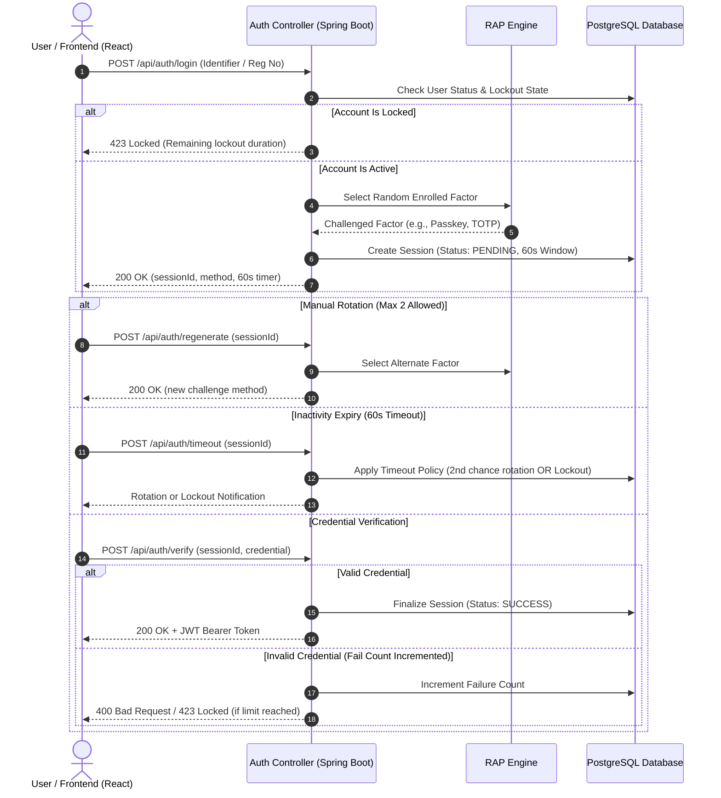

# Randomized Authentication Protocol (RAP)

[](https://www.oracle.com/java/)
[](https://spring.io/projects/spring-boot)
[](https://react.dev/)
[](https://vitejs.dev/)
[](https://www.postgresql.org/)
[](LICENSE)

A robust, enterprise-grade implementation of the **Randomized Authentication Protocol (RAP)**. RAP replaces predictable, static login routines with dynamic entropy—randomly selecting among enrolled multi-factor authentication methods, enforcing real-time inactivity rotations, and applying progressive lockout policies to neutralize brute-force and credential-stuffing attacks.

---

## 📑 Table of Contents

- [Overview & Architecture](#-overview--architecture)
- [Protocol Workflow](#-protocol-workflow)
- [Key Features & Threat Mitigation](#-key-features--threat-mitigation)
- [Security Model & Lockout Policies](#-security-model--lockout-policies)
- [API Reference](#-api-reference)
- [Repository Structure](#-repository-structure)
- [Prerequisites](#-prerequisites)
- [Getting Started](#-getting-started)
  - [Database Setup](#1-database-setup)
  - [Backend Configuration](#2-backend-configuration)
  - [Frontend Configuration](#3-frontend-configuration)
- [Testing & Quality Assurance](#-testing--quality-assurance)
- [Authors & Maintainers](#-authors--maintainers)
- [License](#-license)

---

## 🔍 Overview & Architecture

Standard multi-factor authentication (MFA) implementations typically follow a static sequence (e.g., Primary Password followed by an OTP or Push Notification). This predictable path leaves systems vulnerable to credential stuffing, targeted brute-forcing, and credential fatigue (MFA spamming).

**RAP (Randomized Authentication Protocol)** mitigates these vulnerabilities by introducing non-deterministic verification:
1. **Factor Entropy**: Upon user identification, the server randomly designates an enrolled verification factor (Password, Passkey / FIDO2, Biometric / Fingerprint, or TOTP Authenticator).
2. **Ephemeral Sessions**: Challenges are bound to short-lived sessions (60-second validity windows).
3. **Graceful Rotations**: Supports dynamic method switching (manual quota + automatic timeout fallback).
4. **Progressive Penalties**: Escalating lockout tiers stop automated attackers while preserving legitimate user recovery options.



---

## ✨ Key Features & Threat Mitigation

- **Dynamic Challenge Assignment**: Prevents automated attack scripts from preparing a fixed credential payload ahead of time.
- **Inactivity Auto-Rotation**: If no credential is submitted within 60 seconds, the system seamlessly transitions to an alternative enrolled factor, offering a second attempt before locking.
- **Controlled Manual Regeneration**: Users encountering hardware or connectivity issues with a given method can request a new challenge up to 2 times per session.
- **Stateful JWT Issuance**: Successful verification issues signed JSON Web Tokens for secure downstream resource authorization.
- **Modern Responsive Client**: Built with React 19, Vite, and modern CSS featuring live countdown visualizers, glassmorphism UI, and real-time security alerts.

---

## 🛡️ Security Model & Lockout Policies

To defend against persistent attackers while remaining resilient to accidental user errors, the protocol maintains two distinct, progressive lockout tracking channels:

### 1. Credential Failure Lockout (3 Attempts Limit)
| Threshold | Penalty Duration | Notes |
| :--- | :--- | :--- |
| **1st Lockout** | **5 minutes** | Triggered after 3 consecutive invalid submissions within a session. |
| **2nd Lockout** | **5 minutes** | Warning explicitly rendered indicating subsequent failures result in prolonged ban. |
| **3rd+ Lockout** | **12 hours** | Extended defensive quarantine to block distributed brute-force attacks. |

### 2. Inactivity Timeout Lockout
| Trigger Condition | Penalty Duration | Notes |
| :--- | :--- | :--- |
| **Primary Timeout** | None (Grace Period) | Timer reset + automatic rotation to an alternate factor. |
| **1st Lockout** | **5 minutes** | Triggered if the second 60-second window expires without action. |
| **2nd Lockout** | **12 hours** | Triggered on consecutive session abandonments. |

---

## 📡 API Reference

All endpoints are hosted under `/api`.

### Authentication Endpoints (`/api/auth`)

| Method | Endpoint | Description | Auth Required |
| :--- | :--- | :--- | :--- |
| `POST` | `/api/auth/register` | Register a new user with credentials for enrolled factors | No |
| `POST` | `/api/auth/login` | Initiate RAP session; returns randomized challenge factor | No |
| `POST` | `/api/auth/verify` | Submit credential payload for challenged factor | No |
| `POST` | `/api/auth/regenerate` | Manually rotate the challenge factor (max 2 per session) | No |
| `POST` | `/api/auth/timeout` | Notify backend of 60s timer expiration for rotation/lockout | No |

### User Endpoints (`/api/users`)

| Method | Endpoint | Description | Auth Required |
| :--- | :--- | :--- | :--- |
| `GET` | `/api/users/me` | Fetch authenticated user profile and enrollment details | Bearer JWT |
| `GET` | `/api/users` | List registered users (Administrative) | Bearer JWT |
| `GET` | `/api/users/email/{email}` | Look up user profile by email | Bearer JWT |

---

## 📁 Repository Structure

```text
.
├── backend/
│   ├── src/
│   │   ├── main/
│   │   │   ├── java/com/rapauth/rapauth/
│   │   │   │   ├── config/          # Security & WebMvc configuration
│   │   │   │   ├── controller/      # REST API endpoints (Auth, User)
│   │   │   │   ├── dto/             # Data Transfer Objects
│   │   │   │   ├── entity/          # JPA Hibernate entities (User, Session, Credential)
│   │   │   │   ├── enums/           # Protocol enums (AuthenticationMethod, Status)
│   │   │   │   ├── exception/       # Global exception handlers & custom errors
│   │   │   │   ├── repository/      # Spring Data JPA repositories
│   │   │   │   ├── security/        # JWT utilities & filters
│   │   │   │   ├── service/         # Core RAP authentication business logic
│   │   │   │   └── util/            # Data mappers and helpers
│   │   │   └── resources/
│   │   │       ├── db/migration/    # Flyway schema migrations
│   │   │       └── application.properties
│   │   └── test/                    # Comprehensive unit & lockout integration tests
│   └── pom.xml                      # Maven project configuration
├── frontend/
│   ├── src/
│   │   ├── pages/                   # Login, Register, Dashboard views
│   │   ├── App.jsx                  # Application routing & state management
│   │   ├── index.css                # Global design system & theme styling
│   │   └── main.jsx                 # Client entrypoint
│   ├── package.json                 # Node dependencies
│   └── vite.config.js               # Vite configuration
└── README.md
```

---

## 📋 Prerequisites

Before running the project locally, ensure you have installed:
- **Java Development Kit (JDK)**: Version 17 or later
- **Apache Maven**: Version 3.8+ (or use the included `./mvnw` wrapper)
- **Node.js**: Version 18.x or 20.x
- **PostgreSQL**: Version 14+ running locally on port `5432`

---

## 🚀 Getting Started

### 1. Database Setup

Create a PostgreSQL database named `rapauth`:

```sql
CREATE DATABASE rapauth;
```

Flyway database migrations will automatically apply table schemas on backend startup.

### 2. Backend Configuration

1. Navigate to the `backend/` directory:
   ```bash
   cd backend
   ```

2. Review or update your credentials in `src/main/resources/application.properties`:
   ```properties
   spring.datasource.url=jdbc:postgresql://localhost:5432/rapauth
   spring.datasource.username=postgres
   spring.datasource.password=your_password
   spring.jpa.hibernate.ddl-auto=validate
   ```

3. Launch the Spring Boot application:
   ```bash
   ./mvnw spring-boot:run
   ```
   *The backend will boot on `http://localhost:8080`.*

### 3. Frontend Configuration

1. Navigate to the `frontend/` directory:
   ```bash
   cd frontend
   ```

2. Install client dependencies:
   ```bash
   npm install
   ```

3. Start the development server:
   ```bash
   npm run dev
   ```
   *The client interface will be available at `http://localhost:5173`.*

---

## 🧪 Testing & Quality Assurance

The backend includes automated test coverage verifying the progressive lockout thresholds, session state invalidations, and timer behaviors.

To run the lockout policy test suite:

```bash
cd backend
./mvnw test -Dtest=AuthServiceLockoutTests
```

To execute all tests across the backend:

```bash
cd backend
./mvnw clean test
```

---

## 👥 Authors & Maintainers

- **Jaiwanth MJ**
- **Jaya Aadhavan CK**
- **Harish Ragav S**

---

## 📄 License

This project is open-source and distributed under the [MIT License](LICENSE).

